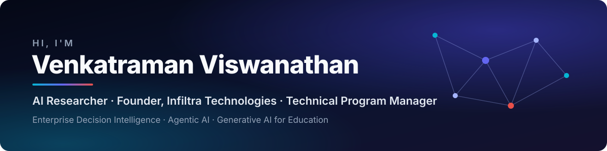

  

  
  
  
  
  

---

### 👋 About me

I'm a **Technical Program Manager and AI researcher** working where enterprise systems, AI-enabled platforms and digital transformation meet. I founded **Infiltra Technologies** to turn applied AI research into products that schools and enterprises use every day.

- 💼 **Technical Program Manager** @ Pacer Group
- 🚀 **Founder & Director** @ [Infiltra Technologies Pvt. Ltd.](https://www.infiltratechnologies.com) — AI research & enterprise products
- 📝 **Associate Editor**, *Journal of Information Systems Engineering and Management* (JISEM)
- 🎓 Post-Graduate Program in Generative AI & ML, Illinois Institute of Technology (2026)

  
  
  
  

---

### 🏢 Infiltra Technologies

<table>
  <tr>
    <td width="50%" valign="top">
      <b><a href="https://www.infiltratechnologies.com">Infiltra Technologies</a></b> 
      AI research & enterprise technology · Chennai, India · since 2017  
      Intelligent products for <b>education, enterprise and entertainment</b> — built on published research in decision intelligence, agentic AI and human-centred generative AI.
    </td>
    <td width="50%" valign="top">
      <b>Products</b>  
      🧠 <a href="https://ainetro.com"><b>AINETRO™</b></a> — the all-in-one <b>HR & KPI platform</b>: Core HR, performance & KPIs, time & attendance, payroll, hiring — with AI workforce insights. <i>Intelligence Behind Every Decision.</i>  
      🏫 <a href="https://infagents.com"><b>INFAGENT™</b></a> — the <b>AI-powered school operating system</b>: a branded school app and platform for communication, administration and parent engagement.
    </td>
  </tr>
</table>

---

### 🔬 Research & expertise

| Area | Focus |
|---|---|
| 🤖 **Agentic AI** | Multi-agent coordination, Model Context Protocol, autonomous enterprise architectures |
| 📊 **Enterprise Decision Intelligence** | Frameworks that turn enterprise data, analytics and knowledge into decisions |
| 👥 **Workforce & Talent Intelligence** | AI-augmented workforce optimization, skills intelligence, human–AI collaboration |
| 🎓 **Generative AI for Education** | Human-centred GenAI, RAG-based learning systems, voice-enabled tutoring |
| 🏗️ **Program Governance** | Enterprise SaaS delivery, cloud platforms, digital transformation |

### 📚 Selected publications

Google Scholar: <b>133 citations · h-index 8 · i10-index 8</b> (October 2026) · <a href="https://scholar.google.com/citations?user=nkQ-kXwAAAAJ&hl=en">full list ↗</a>

| Publication | Venue | Year | Cited by |
|---|---|---|---|
| [AI-Augmented Decision Intelligence for Enterprise Systems: Integrating Cognitive Analytics for Resource and Talent Optimization](https://www.researchgate.net/publication/398268838_AI-Augmented_Decision_Intelligence_for_Enterprise_Systems_Integrating_Cognitive_Analytics_for_Resource_and_Talent_Optimization) | Journal of Information Systems Engineering and Management (JISEM) 8(2) | 2023 | 26 |
| Generative AI for Smarter Workforce Planning and Enterprise Resource Decisions | Journal of Information Systems Engineering and Management (JISEM) 8(4) | 2023 | 22 |
| Agentic AI for Employment: Reducing Unemployment through Intelligent Job-Seeker Support | Lex Localis – Journal of Local Self-Government 23(S4) | 2025 | 20 |
| AI-Augmented Threat Intelligence for Proactive Intrusion Detection in Multi-Cloud Ecosystem | IEEE International Conference on Advanced Computing Technologies (ICACT) | 2025 | 17 |
| A Multi-Agent Voice-Based AI System for Hybrid Learning Using RAG (Capstone Report) | Zenodo · [doi:10.5281/zenodo.23443888](https://doi.org/10.5281/zenodo.23443888) | 2026 | — |

---

### 📌 Featured repositories

| Repository | What's inside |
|---|---|
| 📚 [**research-whitepapers**](https://github.com/VenkyRaju708/research-whitepapers) | Whitepapers & frameworks: Enterprise Decision Intelligence, Agentic AI for Enterprise Systems, Enterprise Knowledge Systems, AI-Augmented Workforce Optimization |
| 🧭 [**enterprise-decision-intelligence**](https://github.com/VenkyRaju708/enterprise-decision-intelligence) | Research themes, objectives and architecture diagrams for AI-driven enterprise decision-making |
| 🎙️ [**multi-agent-hybrid-learning-system**](https://github.com/VenkyRaju708/multi-agent-hybrid-learning-system) | Capstone research: architecture and design of a voice-based multi-agent learning system (RAG, FAISS) · [DOI](https://doi.org/10.5281/zenodo.23443888) |
| 🌐 [**VenkatramanLabs**](https://github.com/VenkyRaju708/VenkatramanLabs) | Source for my personal site, [venkatramanlabs.com](https://venkatramanlabs.com) |

---

### 🛠️ Tools I work with

  
  
  
  
  
  
  
  

---

  <i>Applying AI research to real-world enterprise and education systems that improve decision-making, learning and service delivery.</i>

